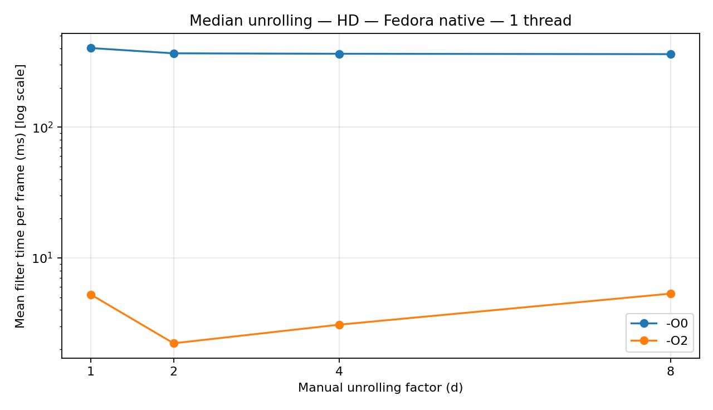
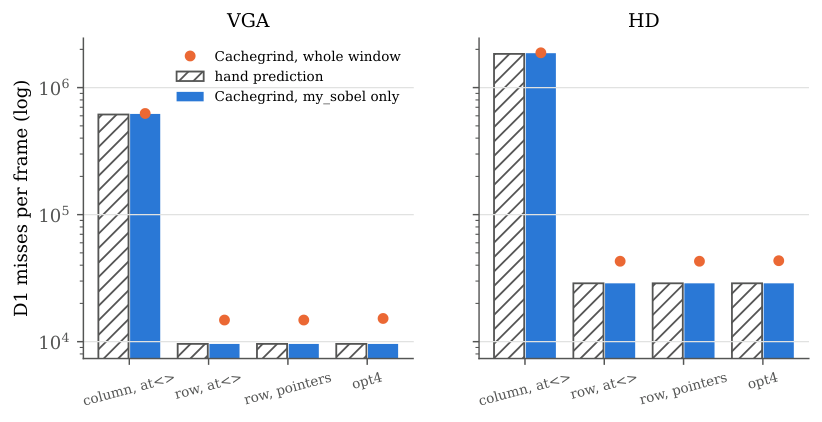
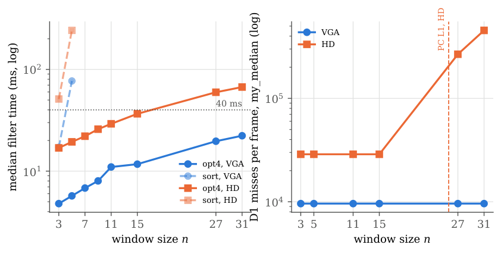
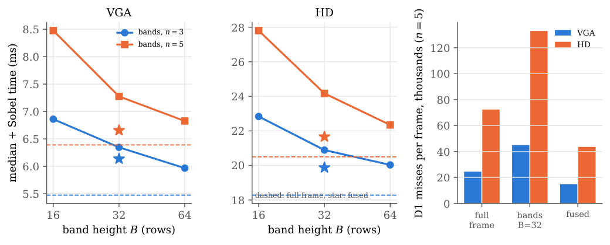

# Results

`raw_logs/` has the console output of our runs and `figures/` a few plots. The per-frame
CSV files and the recorded videos are not in the repo (the videos are of us in front of
the webcam).

Unless written otherwise, the laptop runs used `webcam_bench` with a recorded video,
120 frames of which the first 10 are not counted, and the times below are the median of
the 110 other frames. Every one of these runs had 0 pixels different from OpenCV.
Each configuration was run once, and the CPU frequency was not fixed, so small
differences (a few %) are not meaningful.

## Jetson Orin Nano, opt3 with OpenMP

VGA, n = 3, `-O0`, live camera, mean of 100 frames (`raw_logs/jetson/`). Only the Sobel
is parallel in opt3, which is why the median does not change.

| Threads | Median (ms) | Sobel (ms) |
|---:|---:|---:|
| 1 | 195.14 | 10.67 |
| 2 | 199.30 | 5.31 |
| 4 | 197.93 | 2.82 |
| 6 | 196.41 | 2.17 |

The clock of the board was not locked during these runs.

## opt3 vs opt4 on the laptop, `-O0` and `-O2`

4 OpenMP threads (`raw_logs/fedora/compiler_comparison/`).

| Image | n | Version | Median -O0 (ms) | Median -O2 (ms) | Sobel -O2 (ms) |
|---|---:|---|---:|---:|---:|
| VGA | 3 | opt3 | 73.07 | 13.49 | 0.18 |
| VGA | 3 | opt4 | 39.46 | 5.29 | 0.18 |
| VGA | 5 | opt3 | 271.34 | 60.52 | 0.24 |
| VGA | 5 | opt4 | 49.35 | 5.83 | 0.19 |
| HD | 3 | opt3 | 224.21 | 42.92 | 0.65 |
| HD | 3 | opt4 | 116.33 | 14.54 | 0.56 |
| HD | 5 | opt3 | 799.04 | 180.00 | 0.86 |
| HD | 5 | opt4 | 155.29 | 16.55 | 0.88 |

## Unrolling (laptop, 1 thread)

Times in ms (`raw_logs/fedora/sobel_unrolling/` and `median_unrolling/`).

Sobel:

| Image | Flags | d = 1 | d = 2 | d = 4 | d = 8 |
|---|---|---:|---:|---:|---:|
| VGA | -O0 | 4.839 | 3.683 | 2.783 | 2.448 |
| VGA | -O2 | 0.914 | 0.600 | 0.585 | 0.548 |
| HD | -O0 | 14.442 | 10.745 | 8.928 | 7.396 |
| HD | -O2 | 2.705 | 1.792 | 1.756 | 1.624 |

Median 3×3 (19 compare-exchange network):

| Image | Flags | d = 1 | d = 2 | d = 4 | d = 8 |
|---|---|---:|---:|---:|---:|
| VGA | -O0 | 134.67 | 121.54 | 120.49 | 119.17 |
| VGA | -O2 | 2.002 | 1.046 | 1.370 | 2.129 |
| HD | -O0 | 400.81 | 365.88 | 362.96 | 361.47 |
| HD | -O2 | 5.254 | 2.226 | 3.082 | 5.325 |

The Sobel keeps improving up to d = 8. For the median at `-O2` the best is d = 2. Our
guess is register pressure (x86-64 has only 16 general registers and each window has
9 values), but we did not check the assembly of these builds.

## QEMU ARM64 container

Same benchmark compiled for AArch64 (GCC 13.3, `-O0`) and run under QEMU on the laptop.
These times only say that the code runs and gives the right result on ARM64; QEMU does
not reproduce the speed of the Cortex-A78AE (`raw_logs/qemu_arm64/`).

| Version | Image | n | Threads | Median (ms) | Sobel (ms) |
|---|---|---:|---:|---:|---:|
| opt3 | VGA | 5 | 1 | 5512.2 | 23.38 |
| opt3 | VGA | 5 | 4 | 5533.2 | 7.07 |
| opt4 | VGA | 3 | 4 | 380.4 | 6.82 |
| opt4 | VGA | 5 | 4 | 471.1 | 7.06 |
| opt4 | VGA | 7 | 4 | 581.6 | 6.76 |
| opt4 | VGA | 11 | 4 | 762.1 | 7.31 |
| opt4 | HD | 5 | 4 | 1413.8 | 19.38 |

From n = 3 to n = 11 the opt4 median only gets about 2 times slower, while the window
is 13 times bigger.

## Cache study (report 2)

All on the laptop, one thread, `-O2`. The timings are the median of 110 calls after 10
warm-up calls on one fixed grey frame, and every run printed `VALIDATION PASS`. The miss
counts come from Cachegrind with the laptop caches (`--D1=32768,8,64 --LL=16777216,16,64`);
the counted window is 3 calls, so we divide by 3. Cachegrind is a simulator, and `perf`
counts the whole program, so the two are not directly comparable (see the report).

### Sobel: loop order and `at<>` vs pointers

L1 data misses per frame of `my_sobel`, against our prediction by hand (one input and one
output miss per pixel in column order, `2·W·H/64` in row order). Logs in
`raw_logs/fedora/cache_misses/` (Cachegrind `.log` and `perf` `.perf.txt`) and
`raw_logs/fedora/cache_study/` (timing). `pad 64` adds 64 bytes at the end of each row.

| Image | Variant | Predicted | Cachegrind | Time pad 0 (ms) | Time pad 64 (ms) |
|---|---|---:|---:|---:|---:|
| VGA | column by column, `at<>` | 614 400 | 620 813 | 1.061 | 1.101 |
| VGA | row by row, `at<>` | 9 600 | 9 589 | 0.943 | 0.934 |
| VGA | row by row, pointers | 9 600 | 9 589 | 0.546 | 0.552 |
| VGA | opt4 Sobel | 9 600 | 9 590 | 0.535 | 0.536 |
| HD | column by column, `at<>` | 1 843 200 | 1 866 573 | 3.525 | 3.357 |
| HD | row by row, `at<>` | 28 800 | 28 769 | 2.825 | 2.851 |
| HD | row by row, pointers | 28 800 | 28 769 | 1.641 | 1.666 |
| HD | opt4 Sobel | 28 800 | 28 770 | 1.613 | 1.558 |

The loop order divides the misses by 65 but only saves 11 % (VGA) and 20 % (HD) of the
time. The pointers don't change the misses at all and make the Sobel 1.7 times faster.
Padding does nothing here: a column of the image (960 lines in VGA) is bigger than the
whole 32 KiB L1 (512 lines), so these are capacity misses, not conflicts.

An older `perf` run with the generic `cache-references` / `cache-misses` events is in
`raw_logs/fedora/perf/` and shows the same thing (213 M misses for the column order
against about 75 M for the others, whole program).

### Median: window size

opt4 median for n = 3 to 31 (`raw_logs/fedora/median_sweep/`), and D1 misses per frame of
`my_median` from Cachegrind.

| n | VGA (ms) | VGA misses | HD (ms) | HD misses |
|---:|---:|---:|---:|---:|
| 3 | 4.79 | 9 605 | 16.92 | 28 805 |
| 5 | 5.71 | 9 605 | 19.39 | 28 805 |
| 11 | 10.98 | 9 605 | 29.18 | 28 805 |
| 15 | 11.71 | 9 606 | 36.61 | 28 806 |
| 27 | 19.68 | 9 606 | 59.63 | 267 173 |
| 31 | 22.28 | 9 606 | 67.04 | 454 487 |

The misses jump in HD from n = 27, when n rows of 1280 bytes no longer fit in the 32 KiB
L1, exactly where we expected. It costs less than 1 ms (about 1 % of the time). The
median that sorts the window has the same misses as the histogram but is 3 to 13 times
slower: the median is limited by instructions, not by the memory.

### Bands and fused median + Sobel

Whole pipeline (median then Sobel), `band_fusion_bench`. `full frame` writes the median
image and reads it back; `bands` works on bands of B rows; `fused` keeps only 3 median
rows. Times in ms, misses per frame from Cachegrind (2 measured calls), logs and
`SUMMARY.csv` in `raw_logs/fedora/band_fusion/`.

| Image | n | full frame | bands B=32 | fused | misses full / bands / fused |
|---|---:|---:|---:|---:|---|
| VGA | 3 | 5.47 | 6.35 | 6.14 | |
| VGA | 5 | 6.39 | 7.28 | 6.66 | 24 432 / 44 982 / 14 769 |
| HD | 3 | 18.28 | 20.89 | 19.87 | |
| HD | 5 | 20.50 | 24.17 | 21.66 | 72 404 / 132 926 / 43 573 |

The fused version removes exactly the misses of the intermediate image (2·W·H/64 per
frame), but it runs 2 to 3 % more instructions and ends up 4 to 12 % slower. The bands
recompute the halo rows and copy each band, so they are slower and have more misses.
Larger bands (B = 64) get closer to the full frame.

The same three pipelines were also checked in the QEMU ARM64 container: 20 validation runs,
all `VALIDATION PASS` (`raw_logs/qemu_arm64/band_fusion/`). The QEMU times there are not
meaningful for performance.
