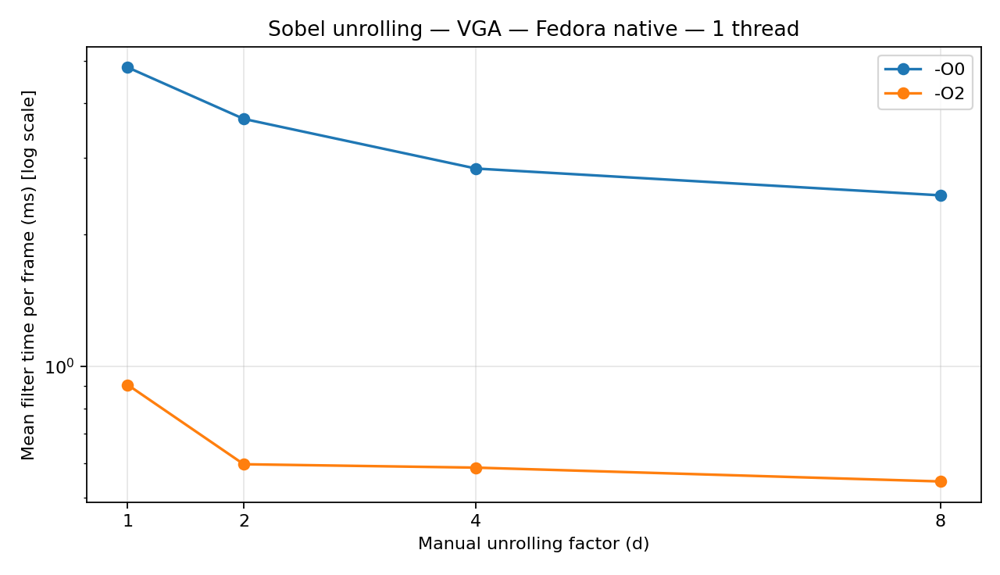

# Results

`raw_logs/` has the console output of our runs and `figures/` a few plots. The per-frame
CSV files and the recorded videos are not in the repo (the videos are of us in front of
the webcam).

Unless written otherwise, the laptop runs used `webcam_bench` with a recorded video,
120 frames of which the first 10 are not counted, and the times below are the median of
the 110 other frames. Every one of these runs had 0 pixels different from OpenCV.
Each configuration was run once, and the CPU frequency was not fixed, so small
differences (a few %) are not meaningful.

## Jetson Orin Nano, opt3 with OpenMP

VGA, n = 3, `-O0`, live camera, mean of 100 frames (`raw_logs/jetson/`). Only the Sobel
is parallel in opt3, which is why the median does not change.

| Threads | Median (ms) | Sobel (ms) |
|---:|---:|---:|
| 1 | 195.14 | 10.67 |
| 2 | 199.30 | 5.31 |
| 4 | 197.93 | 2.82 |
| 6 | 196.41 | 2.17 |

The clock of the board was not locked during these runs.

## opt3 vs opt4 on the laptop, `-O0` and `-O2`

4 OpenMP threads (`raw_logs/fedora/compiler_comparison/`).

| Image | n | Version | Median -O0 (ms) | Median -O2 (ms) | Sobel -O2 (ms) |
|---|---:|---|---:|---:|---:|
| VGA | 3 | opt3 | 73.07 | 13.49 | 0.18 |
| VGA | 3 | opt4 | 39.46 | 5.29 | 0.18 |
| VGA | 5 | opt3 | 271.34 | 60.52 | 0.24 |
| VGA | 5 | opt4 | 49.35 | 5.83 | 0.19 |
| HD | 3 | opt3 | 224.21 | 42.92 | 0.65 |
| HD | 3 | opt4 | 116.33 | 14.54 | 0.56 |
| HD | 5 | opt3 | 799.04 | 180.00 | 0.86 |
| HD | 5 | opt4 | 155.29 | 16.55 | 0.88 |

## Unrolling (laptop, 1 thread)

Times in ms (`raw_logs/fedora/sobel_unrolling/` and `median_unrolling/`).

Sobel:

| Image | Flags | d = 1 | d = 2 | d = 4 | d = 8 |
|---|---|---:|---:|---:|---:|
| VGA | -O0 | 4.839 | 3.683 | 2.783 | 2.448 |
| VGA | -O2 | 0.914 | 0.600 | 0.585 | 0.548 |
| HD | -O0 | 14.442 | 10.745 | 8.928 | 7.396 |
| HD | -O2 | 2.705 | 1.792 | 1.756 | 1.624 |

Median 3×3 (19 compare-exchange network):

| Image | Flags | d = 1 | d = 2 | d = 4 | d = 8 |
|---|---|---:|---:|---:|---:|
| VGA | -O0 | 134.67 | 121.54 | 120.49 | 119.17 |
| VGA | -O2 | 2.002 | 1.046 | 1.370 | 2.129 |
| HD | -O0 | 400.81 | 365.88 | 362.96 | 361.47 |
| HD | -O2 | 5.254 | 2.226 | 3.082 | 5.325 |

The Sobel keeps improving up to d = 8. For the median at `-O2` the best is d = 2. Our
guess is register pressure (x86-64 has only 16 general registers and each window has
9 values), but we did not check the assembly of these builds.

## QEMU ARM64 container

Same benchmark compiled for AArch64 (GCC 13.3, `-O0`) and run under QEMU on the laptop.
These times only say that the code runs and gives the right result on ARM64; QEMU does
not reproduce the speed of the Cortex-A78AE (`raw_logs/qemu_arm64/`).

| Version | Image | n | Threads | Median (ms) | Sobel (ms) |
|---|---|---:|---:|---:|---:|
| opt3 | VGA | 5 | 1 | 5512.2 | 23.38 |
| opt3 | VGA | 5 | 4 | 5533.2 | 7.07 |
| opt4 | VGA | 3 | 4 | 380.4 | 6.82 |
| opt4 | VGA | 5 | 4 | 471.1 | 7.06 |
| opt4 | VGA | 7 | 4 | 581.6 | 6.76 |
| opt4 | VGA | 11 | 4 | 762.1 | 7.31 |
| opt4 | HD | 5 | 4 | 1413.8 | 19.38 |

From n = 3 to n = 11 the opt4 median only gets about 2 times slower, while the window
is 13 times bigger.

## Extra: memory access order (laptop)

We also compared different ways of reading the image in the Sobel with `cache_probe`
(one fixed image, 110 runs after 10 warm-up runs, `-O2`, 1 thread). `pad 64` adds
64 bytes at the end of each row. Logs in `raw_logs/fedora/cache_study/`.

| Variant | VGA pad 0 | VGA pad 64 | HD pad 0 | HD pad 64 |
|---|---:|---:|---:|---:|
| column by column, `at<>` | 1.061 | 1.101 | 3.525 | 3.357 |
| row by row, `at<>` | 0.943 | 0.934 | 2.825 | 2.851 |
| row by row, pointers | 0.546 | 0.552 | 1.641 | 1.666 |
| opt4 Sobel | 0.535 | 0.536 | 1.613 | 1.558 |

`perf stat` on the whole program (VGA Sobel, 3 repetitions, `raw_logs/fedora/perf/`):

| Variant | Instructions | Cache references | Cache misses |
|---|---:|---:|---:|
| column by column, `at<>` | 4 631 172 556 | 630 187 542 | 213 430 849 |
| row by row, `at<>` | 4 704 393 527 | 416 056 929 | 74 688 232 |
| row by row, pointers | 4 009 687 117 | 419 192 777 | 76 773 291 |
| opt4 Sobel | 3 919 252 663 | 418 828 806 | 76 624 376 |

Reading column by column gives almost 3 times more cache misses. These counters are for
the whole process, not only the filter, so they are only good for comparing the variants
with each other.
